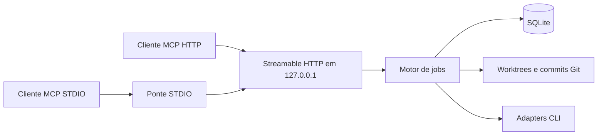

# Arquitetura

O SDK MCP fornece transporte e validação. Cada requisição HTTP tem seu próprio contexto de protocolo, enquanto o motor e a fila são compartilhados. A ponte STDIO encaminha chamadas e recursos para o serviço residente. O SQLite nativo do Node 24 elimina um serviço separado. Um lock exclusivo do SQLite garante uma instância por banco. Uma transação grava cada mudança de estado e seus eventos.

## Contratos MCP

Todas as ferramentas têm o prefixo `hivemind_`. Argumentos desconhecidos são inválidos. Erros de operação incluem um código estável e mensagem em `structuredContent.error`. O recurso `hivemind://skills/orchestrator` serve a mesma skill usada pelo instalador.

| Operação | Ferramentas |
| --- | --- |
| Descoberta | `status`, `list_harnesses`, `list_profiles`, `list_agents` |
| Configuração | `configure_agent` com chave administrativa |
| Liderança | `create_job`, `transfer_job` |
| Planejamento | `decompose_job`, `assign_task`, `review_task` |
| Execução | `approve_task`, `run_task`, `cancel_task`, `retry_task` |
| Inspeção e encerramento | `get_job`, `get_task`, `get_logs`, `finalize_job` |

`create_job` aceita `profile`, `owner`, `objective`, equipe opcional e `requestKey` opcional de 32 bytes aleatórios codificados em hex. Reusar a chave com os mesmos parâmetros torna a criação idempotente. A resposta contém `jobKey`. Chamadas sobre um job exigem `jobId` e `jobKey`. Operações de tarefa exigem `taskId`. O campo `owner` identifica a liderança no histórico. A autorização real vem da chave, guardada como hash e substituída na transferência.

`decompose_job` recebe `tasks` com `id`, `title`, `instructions`, `role` e campos opcionais `mode`, `dependsOn`, `capabilities`, `complexity`, `effort` e `expectChanges`. Tarefas de escrita exigem commit por padrão. Use `expectChanges: false` se um resultado sem alteração for aceitável. `assign_task` recebe `agent` ou escolhe por papel, capacidade, disponibilidade, prioridade e ID. `review_task` exige tarefa concluída e outro agente. `get_logs` aceita `taskId`, `after` e `limit`. `finalize_job` grava o campo `report`.

## Estados e isolamento

O job nasce em `CREATED`. O plano coloca tarefas em `PLANNED`. Aprovação e pedido de execução são ações distintas. A fila libera `QUEUED` quando todas as dependências terminam e há capacidade. `RUNNING` pode terminar em `COMPLETED`, `FAILED`, `CANCELLED` ou `BLOCKED`. Um job aparece em `REVIEWING` enquanto executa uma revisão. Após reiniciar, tarefas anteriormente ativas ou na fila ficam `BLOCKED`. Retry volta a `PLANNED` dentro do limite de tentativas e exige nova ação de execução.

O perfil fixa o HEAD de origem no início do job. Cada tentativa ganha uma branch `hivemind/...` e uma worktree separada. Commits de dependências são reaplicados em ordem topológica. Conflitos bloqueiam a tarefa e preservam a worktree. O núcleo registra commit, arquivos e diff limitado. Depois do encerramento, `hivemind clean <job-id>` pede ao Git que remova worktrees limpas e mantém as branches. Integração de commits na branch de destino é uma operação Git deliberada do operador.

## Effort e roteamento

Codex usa `model_reasoning_effort` e o catálogo `codex debug models`. Claude Code usa `--effort` e a tabela oficial por ID de modelo. OpenCode 2 usa `provider/model#variant` e as variantes da API de catálogo de sua CLI. Provedores ou versões sem detecção podem usar um mapeamento explícito em `effortCatalog.<harness>.<model>.<nível>`, baseado em verificação do operador. O campo `source` distingue catálogos detectados, documentação oficial, verificação do operador e default do harness. O registro da tentativa informa esforço solicitado, selecionado, valor nativo, fallback e aceitação da execução pela CLI. Um valor aceito pela CLI é uma configuração de execução, não uma medição do raciocínio do modelo.

`priority` e `estimatedCost` são dados configurados. O custo estimado é informativo. Tempos e resultados vêm das tentativas. Adapters implementam o contrato `Adapter` em TypeScript. Adicionar um harness novo requer registrá-lo no núcleo nesta versão.

- [Catálogo e configuração do Codex](https://learn.chatgpt.com/docs/config-file/config-reference)
- [Effort no Claude Code](https://code.claude.com/docs/en/model-config#adjust-effort-level)
- [Variantes do OpenCode](https://opencode.ai/docs/models/#variants)
